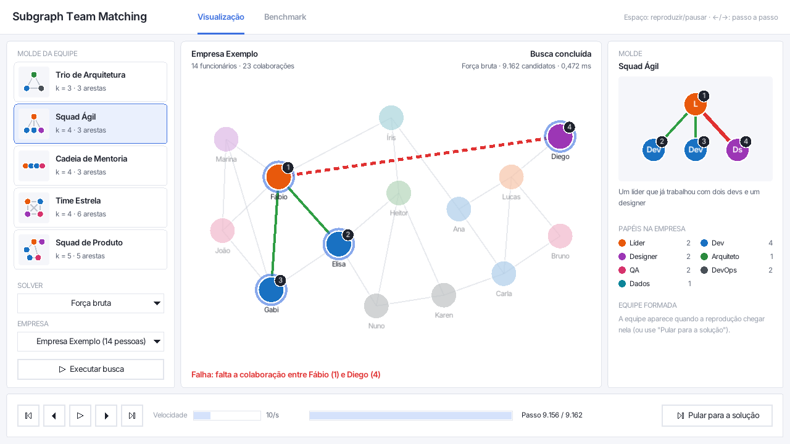
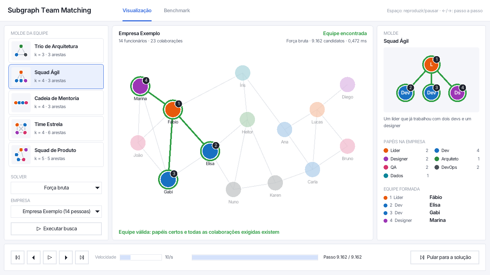
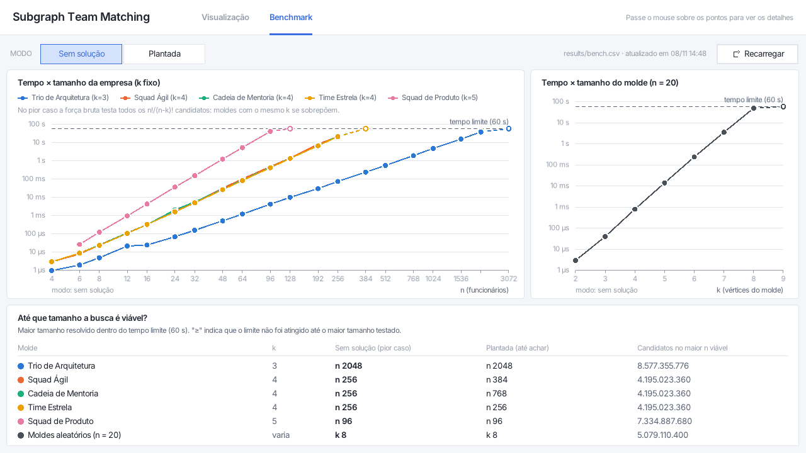

# Subgraph Team Matching

> Matchmaking de equipes usando **Isomorfismo de Subgrafos**, projeto da disciplina de Teoria da Computação.



## O problema

Na hora de montar um time para um projeto complexo, o RH costuma avaliar cada pessoa isoladamente
(quem sabe Java, quem sabe SQL). Só que projetos reais dependem da **dinâmica do grupo**: quem já
trabalhou bem com quem, quem se comunica bem com quem.

Este projeto modela a empresa como um **grafo social**:

- **Vértices** são os funcionários, cada um com um papel (Líder, Dev, Designer, Arquiteto, QA, DevOps, Dados).
- **Arestas** representam um histórico de boa colaboração entre duas pessoas.

A empresa descreve a **equipe ideal** como um grafo pequeno, o "molde". Por exemplo: um líder que já
trabalhou com dois devs e um designer. O sistema procura no grafo da empresa um subgrupo de
funcionários que se encaixe nesse molde. Isso é o problema de **Isomorfismo de Subgrafos**, que é
NP-Completo.

Uma equipe é válida quando: ninguém ocupa duas posições, o papel de cada pessoa é o da posição, e toda
colaboração exigida pelo molde existe entre as pessoas escolhidas (colaborações a mais são permitidas).

## O que o projeto faz

- **Força bruta:** testa todas as escolhas possíveis de funcionários para as posições do molde, em
  `src/solvers/brute_force.cpp`.
- **Interface gráfica:** mostra o passo a passo da busca, candidato por candidato.
- **Benchmark:** mede até que tamanho de entrada a força bruta responde em tempo viável, com gráficos na
  interface.
- **Experimento com LLM:** uma mensagem pronta e o gabarito para testar LLMs generalistas nos mesmos casos
  (pasta [`llm/`](llm/)).

## Como compilar

O projeto é escrito em C++17 e precisa só de um compilador C/C++ e do `make`. A raylib (gráficos) e a raygui
(botões e controles) já vêm dentro do repositório, em `third_party/`, e são compiladas junto. A primeira
compilação leva até um minuto, porque inclui a raylib.

### Linux (Debian/Ubuntu)

```sh
sudo apt install build-essential git libgl1-mesa-dev libx11-dev libxrandr-dev libxi-dev libxcursor-dev libxinerama-dev
git clone https://github.com/kleitonv3/subgraph-team-matching.git
cd subgraph-team-matching
make
```

### Windows

O MinGW antigo (MinGW.org, GCC 6.3) **não** compila a raylib. Use o **w64devkit**, um GCC moderno
portátil, que não precisa de instalador nem de permissão de administrador:

1. Baixe o `w64devkit-x64-<versão>.7z.exe` em <https://github.com/skeeto/w64devkit/releases>
   (versão de referência: 2.10.1).
2. Execute o arquivo e extraia em `C:\`. Ele cria a pasta `C:\w64devkit`.
3. Abra o `C:\w64devkit\w64devkit.exe` (um terminal com o compilador e o `make` configurados), vá até a
   pasta do projeto e rode `make`.

Também dá para usar o terminal de sempre (PowerShell, VS Code): basta colocar `C:\w64devkit\bin` no `PATH`,
no lugar de qualquer outro MinGW. No PowerShell, os programas rodam como `.\bin\teams_bench.exe`.

> **Se o antivírus reclamar:** alguns antivírus (o Kaspersky, por exemplo) às vezes marcam executáveis
> recém-compilados com MinGW como suspeitos. São detecções heurísticas (como `VHO:...`), que acontecem com
> programas sem assinatura digital e que nenhum outro computador executou antes. O executável é gerado na
> sua máquina a partir do código deste repositório. Se acontecer, adicione a pasta `bin/` do projeto às
> exceções do antivírus.

### macOS

Não testado. Deve bastar ter as ferramentas de linha de comando do Xcode (`xcode-select --install`) e rodar
`make`.

### Comandos

| Comando | O que faz |
|---|---|
| `make` | compila a interface (`bin/teams_gui`) e a linha de comando (`bin/teams_bench`) |
| `make run` | abre a interface |
| `make bench` | roda o benchmark (uns 5 minutos) e grava `results/bench.csv` |
| `make bench BENCH_ARGS="--timeout 60"` | o mesmo, com tempo limite de 60 s por execução |
| `make clean` | apaga os arquivos gerados pelo build |

## Interface gráfica

```sh
make run
```

1. No painel da esquerda, escolha um molde (por exemplo **Squad Ágil**) e a empresa (**Empresa Exemplo**,
   14 pessoas, ou empresas geradas com 25, 50 e 100 pessoas).
2. Clique em **Executar busca**. A busca é reproduzida passo a passo:
   - os funcionários do candidato atual ficam em destaque, com o número da posição do molde;
   - papel errado: anel vermelho;
   - colaboração exigida que existe: linha verde; que falta: linha vermelha tracejada;
   - uma frase no rodapé explica o passo, por exemplo "Falha: falta a colaboração entre Fábio (1) e Diego (4)".
3. A reprodução pausa sozinha quando chega na equipe encontrada, que aparece no painel **Equipe formada**.
   No Squad Ágil, isso acontece no passo 9.162, com Fábio, Elisa, Gabi e Marina.

Controles: reproduzir/pausar, passo anterior e próximo, velocidade (1 a 10.000 passos/s), linha do tempo e
**Pular para a solução**. Atalhos: Espaço, ← e →, Home e End. A busca roda em segundo plano e pode ser
cancelada; o limite é de 60 s.



A aba **Benchmark**, no topo, mostra os gráficos e a tabela do `make bench` (veja [Resultados](#resultados)).

## Linha de comando

As entradas são arquivos de texto: a empresa de exemplo (`data/company.txt`) e os moldes
(`data/presets/*.txt`). Os **tempos** variam conforme a máquina; os **resultados** e a **contagem de
candidatos** são sempre os mesmos, porque a busca e as empresas geradas são determinísticas.
A ajuda completa sai com `./bin/teams_bench --help`.

**Listar a empresa e os moldes:**

```
$ ./bin/teams_bench --list
Empresa: data/company.txt
  Empresa Exemplo: 14 funcionários, 23 colaborações
  Papéis: Líder ×2, Dev ×4, Designer ×2, Arquiteto, QA ×2, DevOps ×2, Dados

Presets (data/presets):
  architecture_trio   Trio de Arquitetura   k=3  arestas=3    Dev, Arquiteto, DevOps
  agile_squad         Squad Ágil            k=4  arestas=3    Líder, Dev ×2, Designer
  mentoring_chain     Cadeia de Mentoria    k=4  arestas=3    Líder, Dev ×2, QA
  star_team           Time Estrela          k=4  arestas=6    Líder, Dev, Designer, QA
  product_squad       Squad de Produto      k=5  arestas=5    Líder, Dev ×2, Designer, QA
...
```

**Procurar uma equipe na empresa de exemplo:**

```
$ ./bin/teams_bench --run agile_squad
...
Resultado: equipe encontrada
  Líder      -> Fábio (#5)
  Dev        -> Elisa (#4)
  Dev        -> Gabi (#6)
  Designer   -> Marina (#12)

Candidatos testados: 9.162
Tempo: 0,085 ms
```

**Pior caso: uma empresa gerada de 30 pessoas em que não existe solução.** A força bruta testa todos os
30 · 29 · 28 · 27 = 657.720 candidatos:

```
$ ./bin/teams_bench --run star_team --n 30 --mode nosolution
...
Resultado: sem solução

Candidatos testados: 657.720
Tempo: 4,936 ms
```

**Outras opções úteis:**

| Comando | O que faz |
|---|---|
| `--run agile_squad --all` | continua depois da primeira equipe e conta todas (aqui, 4) |
| `--run product_squad --n 200 --mode nosolution --timeout 5` | para em 5 s e informa "tempo limite estourado" |
| `--run agile_squad --company outro.txt` | usa outra empresa |
| `--generate-company 50 --pattern agile_squad --mode planted --seed 7` | escreve na saída uma empresa gerada (`planted` embute a equipe, `nosolution` garante que não exista nenhuma) |

Erros de entrada saem com o motivo e a linha do arquivo, por exemplo `company.txt:12: papel desconhecido
"Chefe"`, e código de saída 1. Se o algoritmo devolver uma equipe que viola alguma regra, o programa avisa e
termina com código 2.

## Benchmark

```sh
make bench                              # tempo limite de 10 s por execução (uns 5 minutos)
make bench BENCH_ARGS="--timeout 60"    # tempo limite de 60 s
```

Duas séries, cada uma nos modos **sem solução** (pior caso: testa todos os candidatos) e **plantada**
(a empresa tem uma equipe embutida; 3 repetições, com a mediana):

- **n crescente, k fixo:** para cada molde, empresas de 4 a 4096 pessoas (crescimento de ~1,5x).
- **k crescente, n = 20:** moldes gerados com k = 2, 3, 4...

Cada série para no primeiro tamanho que estoura o tempo limite. Os resultados vão para `results/bench.csv`,
uma linha por execução, com as colunas `solver, series, preset, mode, n, k, m, seed, found, candidates,
time_ms, timeout`.

## Resultados

Benchmark com tempo limite de 60 s por execução. A força bruta testa cerca de 175 milhões de candidatos por
segundo.

| Molde | k | Maior n no pior caso (sem solução) | Maior n até achar (plantada) |
|---|---|---|---|
| Trio de Arquitetura | 3 | 2048 | 2048 |
| Squad Ágil | 4 | 256 | 384 |
| Cadeia de Mentoria | 4 | 256 | 768 |
| Time Estrela | 4 | 256 | 256 |
| Squad de Produto | 5 | 96 | 96 |
| Moldes aleatórios, n = 20 | varia | k = 8 | k = 8 |

- **Com k fixo,** o número de candidatos é n!/(n−k)!, que cresce como n^k: polinomial, mas o expoente é o
  tamanho do molde. Cada pessoa a mais no molde derruba o maior n viável (2048 → 256 → 96).
- **Com k crescendo** numa empresa de só 20 pessoas, cada posição a mais multiplica o número de candidatos por
  n − k + 1 e o tempo por 14 a 20: de 0,8 ms com k = 4 para 50 s com k = 8, e k = 9 já passa de 60 s. É a
  explosão típica de um problema NP-Completo.
- **No pior caso, moldes com o mesmo k levam o mesmo tempo,** porque a força bruta testa todos os candidatos,
  sejam quais forem as colaborações exigidas.



## Formato dos arquivos de entrada

Um arquivo de texto por grafo. Exemplo (`data/presets/agile_squad.txt`):

```
name Squad Ágil
desc Um líder que já trabalhou com dois devs e um designer
vertices 4
# id  papel     nome  x     y
0     Lider     -     0.50  0.15
1     Dev       -     0.15  0.80
2     Dev       -     0.50  0.80
3     Designer  -     0.85  0.80
edges 3
0 1
0 2
0 3
```

- Vértices com id `0, 1, 2, ...` em ordem e papel `Lider`, `Dev`, `Designer`, `Arquiteto`, `QA`, `DevOps`
  ou `Dados`.
- Nome e posição na tela (x e y entre 0 e 1) são opcionais; `-` significa sem nome, e `_` vira espaço.
- Cada linha depois de `edges` é uma aresta não direcionada `a b`. Tudo depois de `#` é comentário.

## Experimento com LLM

A pasta [`llm/`](llm/) tem a segunda parte do trabalho: avaliar como uma LLM generalista resolve os mesmos
casos.

- [`llm/prompt.md`](llm/prompt.md): a mensagem, com 7 casos (dois deles sem solução);
- [`llm/answers.md`](llm/answers.md): o gabarito, com todas as equipes válidas de cada caso;
- [`llm/results.md`](llm/results.md): os testes feitos.

ChatGPT, Gemini 3.5 Flash Lite e Claude Sonnet 5.5 acertaram os 7 casos. Mas as justificativas variaram:
uma tinha um argumento falso, outra não mostrava o raciocínio. As três declararam confiança de 97% a 100%
em todas as respostas. A força bruta resolve os mesmos casos em menos de 1 segundo e com garantia de
correção, inclusive para afirmar que não existe solução.

## Estrutura do projeto

```
src/
  graph.*              grafo e leitura dos arquivos
  solver.hpp           contrato entre os algoritmos e o resto do sistema
  context.cpp          SearchContext (trace, contagem, tempo limite) e runSolver
  generator.*          gerador de empresas e moldes
  solvers/
    brute_force.cpp    algoritmo de força bruta
    registry.cpp       lista de solvers (novos algoritmos aparecem sozinhos na interface e no benchmark)
  gui/                 interface gráfica (raylib + raygui)
  bench/               linha de comando e séries do benchmark
data/                  empresa de exemplo e moldes
llm/                   experimento com LLM
third_party/           raylib e raygui
```

As decisões de projeto, o contrato dos solvers e as fases de implementação estão em [SPEC.md](SPEC.md).

## Bibliotecas e recursos de terceiros

| O quê | Onde | Licença |
|---|---|---|
| [raylib](https://github.com/raysan5/raylib) 5.5 | `third_party/raylib/` | zlib |
| [raygui](https://github.com/raysan5/raygui) 4.0 | `third_party/raygui/` | zlib |
| Fonte [Inter](https://github.com/rsms/inter) 4.1 | `assets/fonts/` | SIL Open Font License 1.1 |

## Licença

[MIT](LICENSE)
